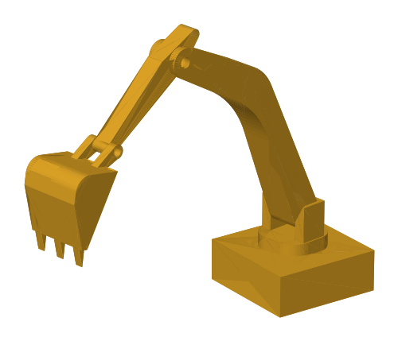
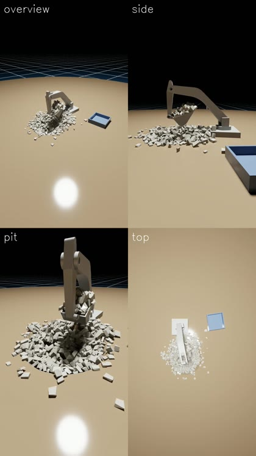
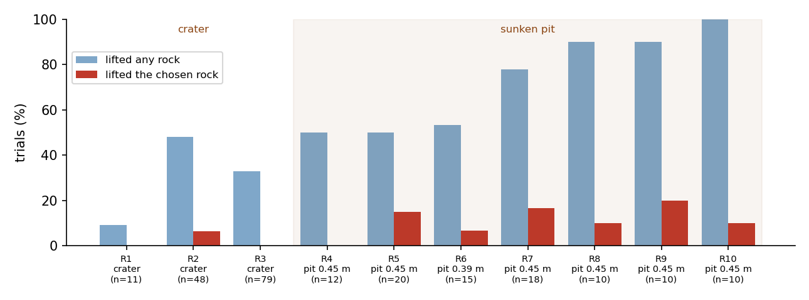

# Excavator Simulation in NVIDIA Isaac Sim

A four-joint excavator designed in Fusion 360, exported as a ROS 2 URDF package and simulated in **NVIDIA Isaac Sim 5.1**: it digs limestone out of a pit with its own kinematics and motion planning, and records itself from several cameras.

<p align="center">
  
  &nbsp;&nbsp;
  
</p>

- **CAD to simulation:** Fusion 360 model → URDF → USD articulation with position-driven joints
- **Kinematics from scratch:** forward and inverse kinematics of the bucket's cutting edge, checked against the simulator
- **Dig site:** 900 limestone rocks, each a rigid body, in a sunken pit, plus a dump bin
- **Collision-aware motion:** collision-free joint ranges measured from the meshes, and plans that keep the whole bucket out of the dirt
- **Live control without restarts:** keyboard driving, saving poses and replaying them as smooth paths, an automatic pick-up, all hot-reloaded while the sim runs
- **Multi-camera recording** to MP4, plus a [trial-and-error report](docs/pick_rock/pick_rock_report.pdf) of 237 headless pick-up trials

## 3D model

Click an STL file below to rotate and zoom it in GitHub's 3D viewer.

- **Full excavator (CAD export):** [`Excavator_Final.stl`](Excavator_Final.stl)
- **Parts:** [base](Excavator_Final_description/meshes/base_link.stl) · [cab](Excavator_Final_description/meshes/base_joint_1_1.stl) · [arm](Excavator_Final_description/meshes/arm_1_1.stl) · [pole](Excavator_Final_description/meshes/Pole_1.stl) · [bucket](Excavator_Final_description/meshes/Bucket_1.stl)

## Robot

| Joint | Motion | Collision-free range |
|---|---|---|
| `swing_joint` (Z axis) | Rotates the cab on the base | unlimited |
| `arm_joint` (boom) | Raises / lowers the arm | −50° … 110° |
| `pole_joint` (stick) | Swings the pole at the end of the arm | −5° … 130° |
| `bucket_joint` | Curls the bucket | −8° … 278° |

Links: `base_link` → `base_joint_1_1` (cab) → `arm_1_1` (arm) → `Pole_1` (pole) → `Bucket_1` (bucket)

All joints are `continuous` in the CAD export, and Isaac Sim doesn't collide neighbouring links, so **nothing in the simulator stops a link from passing through the next one**. The ranges above were measured by rotating each link mesh against its neighbour and live in `kinematics.JOINT_LIMITS`. The planner, the keyboard clamps and the sweep demos all stay inside them. The bucket hits the stick between −80° and −10°, so its range runs the long way round: a pose at −160° has to be reached as +200°.

## Repository layout

```
.
├── Excavator_Final.stl               # Full excavator exported from CAD (mm)
├── run_live.sh                       # Start the live sim (refuses if Isaac Sim is already running)
├── Excavator_Final_description/      # ROS 2 description package
│   ├── urdf/
│   │   ├── Excavator_Final.urdf      # Flattened URDF imported into Isaac Sim (renamed joints, relative mesh paths)
│   │   ├── Excavator_Final.xacro     # Original CAD export, used by the ROS 2 launch files
│   │   └── Excavator_Final/          # USD generated by the Isaac Sim URDF importer
│   ├── meshes/                       # STL meshes, one per link
│   ├── launch/                       # RViz / Gazebo launch files
│   └── config/
├── docs/
│   ├── excavator.png, sim_grid.jpg   # Pictures above
│   ├── pick_rock/                    # Pick-up trials: report PDF, plots, trials.json
│   └── videos/                       # Your recordings (git-ignored)
└── scripts/
    ├── run_live.py                   # Starts the sim, hot-reloads live_controller.py and rocks.py
    ├── live_controller.py            # Keys, home pose, paths, cameras: edit while the sim runs
    ├── rocks.py                      # Rock pile, pit and dump bin: edit while the sim runs
    ├── kinematics.py                 # Forward / inverse kinematics + joint ranges (plain numpy)
    ├── check_kinematics.py           # Checks kinematics.py against the simulator
    ├── getpose.py                    # Find and save poses for your own paths (plain Python)
    ├── poses.json                    # Saved poses (G key / getpose.py --save)
    ├── pick_motion.py                # Plans the automatic rock pick-up (plain numpy)
    ├── pick_rock.py                  # Headless pick-up trials -> docs/pick_rock/
    ├── plot_pick.py                  # Side-view plots of those trials
    ├── recorder.py                   # Multi-camera video recording (V key)
    ├── import_urdf.py                # Headless URDF -> USD import
    ├── excavator_control.py          # Standalone sweep demo
    ├── excavator_keyboard.py         # Standalone keyboard demo
    └── make_preview.py               # Renders docs/excavator.png from Excavator_Final.stl
```

## Requirements

- Ubuntu 22.04
- NVIDIA RTX GPU
- [Isaac Sim 5.1](https://docs.isaacsim.omniverse.nvidia.com/) (standalone install, e.g. `~/isaacsim`)
- System Python 3 with numpy (for `getpose.py`, `kinematics.py`, `pick_motion.py`); matplotlib for `plot_pick.py`

Developed on an i9-13900H (20 threads), 15 GB RAM and an RTX 4070 Laptop GPU. The full scene uses about 5 GB of RAM.

## Quick start

### 1. Import the URDF (once, and again whenever the URDF changes)

With Isaac Sim closed:

```bash
~/isaacsim/python.sh scripts/import_urdf.py
```

It writes `urdf/Excavator_Final/Excavator_Final.usd` (fixed base, position drives, convex decomposition for the bucket) and prints the joints it found. Or in the GUI: **File → Import** the URDF with a **Fixed** base and **Position** joint drives.

### 2. Start the live sim

```bash
./run_live.sh
```

The pile is poured with the arm at its home pose. Wait for `[rocks] pile settled …`, then **click inside the viewport** so it gets the keyboard.

## Controls

| Key | Does |
|---|---|
| ← / → | Swing the cab |
| Q / A | Boom up / down |
| W / S | Stick |
| E / D | Bucket |
| **R** | Move smoothly back to the home pose |
| **T** | Put the rocks back into the settled pile |
| **G** | Save the current pose (plus the top rock positions) to `POSE_FILE` |
| **Y** | Play the saved poses as one smooth path |
| **P** | Automatic pick-up of a rock from the pit |
| **V** | Start / stop recording video |

Joints move at about 29°/s while a key is held and stop at their collision-free ranges. Joint angles are printed in the terminal while the arm moves.

### Settings in `scripts/live_controller.py`

Save the file and changes apply within about half a second, with no restart. If it has an error, the traceback is printed and the last working version keeps running.

| Setting | What it does |
|---|---|
| `MODE` | `"keyboard"` (default) or `"sweep"` (automatic back-and-forth motion) |
| `HOME` | Where **R** goes and where the sim starts: `None` (all zeros), a saved pose name like `"live_1"`, or `[swing, arm, pole, bucket]` in radians. The start pose needs a restart. |
| `POSE_FILE` | Pose file in `scripts/` that **G** saves to and **Y** plays, e.g. `"dig.json"` for a separate path |
| `PATH` | `None` plays every pose in the file in saved order; or a list of `(pose name, seconds)` |
| `PATH_SECONDS` | Seconds per move when `PATH` is `None` |
| `PATH_SMOOTH` | `True`: flow through the middle poses without stopping; `False`: stop at every pose |
| `CAMERAS`, `RECORD_RESOLUTION`, `RECORD_EVERY` | Recording cameras (position, target, lens), size per camera, physics steps per frame |
| `KP`, `KD`, `SPEED`, `JOINT_KEYS` | Drive gains, jog speed, key bindings and clamps |

## Planning your own path

1. **Find poses.** Jog the arm and press **G**, or work out poses from where the bucket should be:

   ```bash
   python3 scripts/getpose.py pile                        # where the pit and bin are
   python3 scripts/getpose.py ik 0.08 -0.48 0.0 2.5       # cutting edge x y z + pitch -> joint angles
   python3 scripts/getpose.py fk 0 -17 0 199 --deg        # joint angles -> cutting edge position
   python3 scripts/getpose.py ik 0.08 -0.48 0.0 2.5 --save dig_start
   ```

   Positions are in metres (world frame, ground at z = 0) for the middle of the bucket's cutting edge. Pitch is the bucket angle: **2.5** = edge pointing down and back to dig, **0.5** = opening up to carry, about **3.5** = tipped forward to dump. Every pose is checked against the joint ranges and against the dirt; problems are printed.

2. **Manage poses.**

   ```bash
   python3 scripts/getpose.py list                        # what's saved
   python3 scripts/getpose.py rename live_3 lift
   python3 scripts/getpose.py delete live_6 live_7
   python3 scripts/getpose.py clear                       # start over (old file kept as a backup)
   python3 scripts/getpose.py files                       # all pose files
   ```

   Add `--file NAME` before the command to work on another pose file, e.g. `getpose.py --file dig list`.

3. **Play them.** Press **T**, **R**, then **Y**. Edit `PATH` / `PATH_SECONDS` / `PATH_SMOOTH` and press **Y** again.

Moves are straight lines in joint space, so they stay inside the joint ranges as long as every pose does. They aren't checked against the dirt between poses; watch moves that go into the pit.

## The rock pile (`scripts/rocks.py`)

Saving `rocks.py` while the sim runs rebuilds the pile and re-pours it, keeping the arm where it is; a broken edit keeps the old scene.

| Setting | Default |
|---|---|
| `NUM_ROCKS` | 900 (physics slows down as this grows; try ~600 if the sim feels slow) |
| `ROCK_TYPE` | `"limestone"` (pale, flat, ~2.5 cm) or `"granite"` (grey 2 cm blocks) |
| `PILE_STYLE` | `"pit"`: rocks in a 15 cm deep hole (21 cm rim radius) sunk into a dirt slab. Also `"crater"`, `"mound"`, `"box"`. Switching to or from `"pit"` moves the ground plane and needs a restart. |
| `PIT_*`, `PILE_DISTANCE` | Pit size and how far out it is (0.40 m from the swing axis) |
| `DUMP_BIN`, `BIN_*` | Dump bin at swing +90° |

Why a pit: on flat ground the bucket just bulldozes loose rocks ahead of it. In a pit the walls hold them while the lip passes underneath. Loose PhysX rocks also don't hold a free-standing heap, and round rocks roll down any slope, so the rocks are flat-faced blocks with a pit around them.

## Automatic pick-up and the trial-and-error report

**P** plans a pick for the highest reachable rock near the pit centre (`pick_motion.py`): an edge-first drag toward the machine, a curl, and a boom lift with the bucket tilted back. Every joint target is computed by IK, stays inside the joint ranges, and keeps the whole bucket clear of the dirt.

Headless trials (Isaac Sim closed):

```bash
~/isaacsim/python.sh scripts/pick_rock.py final --targets=10   # run the final motion on 10 target rocks
/usr/bin/python3 scripts/plot_pick.py final                    # side-view plot -> docs/pick_rock/final.png
```

Latest result: the bucket lifted and held rocks in **10 of 10** trials, but caught the specific rock it aimed at in only **1 of 10**, so aiming at one rock is still unreliable. In the bigger 900-rock pit, scoops bring up 20–30 rocks.

The [report](docs/pick_rock/pick_rock_report.pdf) walks through every round that failed and why: jamming in the crater wall, the heel digging into the ground, rocks being bulldozed, the wrong IK branch, and a motion that turned the bucket through the stick.

<p align="center"></p>

## Kinematics

`scripts/kinematics.py` models the arm as a swing turntable plus a 3-link planar arm (boom 0.446 m, stick 0.191 m, bucket 0.193 m), with all geometry read from the URDF and the bucket mesh. IK is analytic (law of cosines).

```bash
python3 scripts/kinematics.py                        # math self-test: fk -> ik -> fk round trip
~/isaacsim/python.sh scripts/check_kinematics.py     # against the simulator (Isaac Sim closed)
```

Against the simulator, over 200 random poses: forward kinematics matches the simulated bucket exactly (0.00 mm). Inverse kinematics lands 0.95 mm from the target on average (2.4 mm worst), all of it from the arm sagging under gravity during the measuring step. This checks the math against the simulated robot. The URDF's joint origins are themselves 7–14 mm off from the Fusion 360 assembly.

## Recording video

Press **V** to start, **V** again to stop. Each camera in `CAMERAS` gets its own MP4, plus a grid video with all of them side by side, in `docs/videos/`. If ffmpeg with libx264 is available, the files are re-encoded to H.264 in the background so they play everywhere, including browsers and social media.

- **Look through a camera:** in the viewport, click **Perspective → Cameras** and pick one under `RecCams`. Click its lock icon so mouse navigation can't move it.
- **Move a camera:** edit its `eye` (position) and `target` (what it looks at) in `CAMERAS` and save.
- Videos follow sim time, so they play at real speed even when the sim runs slower.
- For phone short-form video, use `RECORD_RESOLUTION = (720, 1280)` (9:16) and fewer cameras.

## Standalone demos

These set up the same robot without the rocks or hot-reloading:

```bash
~/isaacsim/python.sh scripts/excavator_control.py    # sweep all joints within JOINT_MOTION
~/isaacsim/python.sh scripts/excavator_keyboard.py   # drive with the keys above (R resets to 0)
```

### Regenerating the preview image

After replacing `Excavator_Final.stl`, re-render `docs/excavator.png` with the system Python (needs numpy, matplotlib and Pillow):

```bash
python3 scripts/make_preview.py
```

## Troubleshooting

- **Isaac Sim crashes or freezes:** usually memory. Run only one Isaac Sim at a time: `run_live.sh` refuses to start a second one, but headless scripts don't check, so close the GUI before running them.
- **Keys do nothing:** click inside the viewport first so it has keyboard focus.
- **A link passes through another:** a joint went outside its collision-free range. Check your poses with `getpose.py fk`; anything outside the ranges is flagged.
- **The sim runs slowly:** the main thread maxes out one CPU core. Lower `NUM_ROCKS`, shrink the viewport window, or record with fewer or smaller cameras.
- **`[path] not in poses.json`:** `PATH` names a pose that isn't in `POSE_FILE`. Check with `getpose.py list`, or set `PATH = None` to play whatever is saved.
- **A recording comes out empty:** check the `[rec]` lines in the terminal. If the camera pipeline broke mid-session, restart the sim.
- **Robot tips over or slides:** re-import with a **Fixed** base.
- **Arm oscillates:** lower the gains (`KP` in `live_controller.py`, `kps` in the standalone scripts), e.g. to `1e3`.
- **Don't run the scripts from Isaac Sim's Script Editor.** They create their own `SimulationApp` and must be run with `python.sh`.
